# Cameron’s Sofle keymap



Features:

-   Symmetric modifiers (CMD/Super, Alt/Opt, Ctrl, Shift)
-   Various modes, can be switched (using Adjust layer and the selected one is stored in EEPROM.
-   Modes for Qwerty and Colemak support
-   Modes for Mac vs Linux/Win support -> different order of modifiers and different action shortcuts on the "UPPER" layer (the red one in the image). Designed to simplify transtions when switching between operating systems often.
-   In Linux/Win mode, Alt+C and Alt+V send Ctrl+C and Ctrl+V; Shift is preserved for terminal copy/paste shortcuts. Mac mode passes Alt+C/V through unchanged.
-   The OLED on master half shows selected mode and caps lock state and is rotated.
-   Left encoder controls volume up/down/mute. Right encoder PGUP/PGDOWN.

# MY NOTES

https://config.qmk.fm/#/sofle/rev1/LAYOUT
https://docs.qmk.fm/#/newbs_building_firmware

-   folder name is km name inside this folder

qmk json2c map.json -o map.c

## Compile and flash both halves

From the userspace root, compile the firmware:

```sh
qmk userspace-compile
```

**Never connect or disconnect the TRRS cable between the halves while either half is powered. Disconnect both halves from USB and any other power source before inserting or removing the cable.**

Flash each half separately, with the TRRS cable disconnected:

1. With both halves unpowered, disconnect the TRRS cable joining them.
2. Plug only one half into the computer via USB.
3. Run:

   ```sh
   qmk flash sofle_rev1_cameronchan.hex
   ```

4. Press the reset button on that physical keyboard half when QMK is waiting for the bootloader, then wait for flashing to complete successfully.
5. Unplug the flashed half from USB.
6. Plug in the other half via USB and repeat steps 3–5 using the same firmware file.
7. Once both halves are disconnected from all power, reconnect the TRRS cable. Only then reconnect USB to use the keyboard.

## Keymap diagram

Regenerate the diagram from the userspace root with:

```sh
./draw-keymap.sh keyboards/sofle/keymaps/cameronchan/map.json
```

You can also pass the directory containing `map.json` instead of the file path. The script requires `keymap-drawer` (`keymap` on `PATH`) and writes `keymap.svg` beside the source map without changing firmware files.
